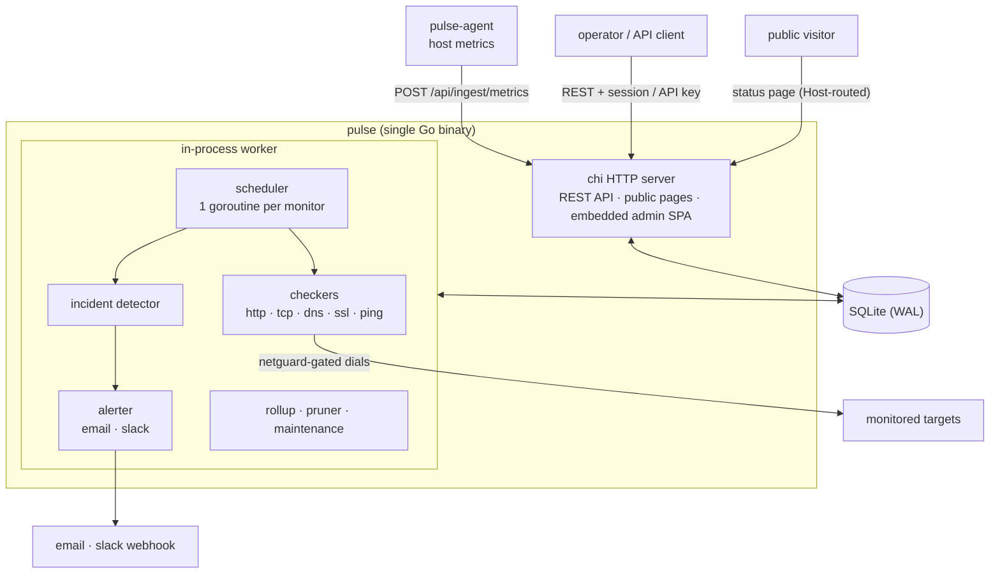
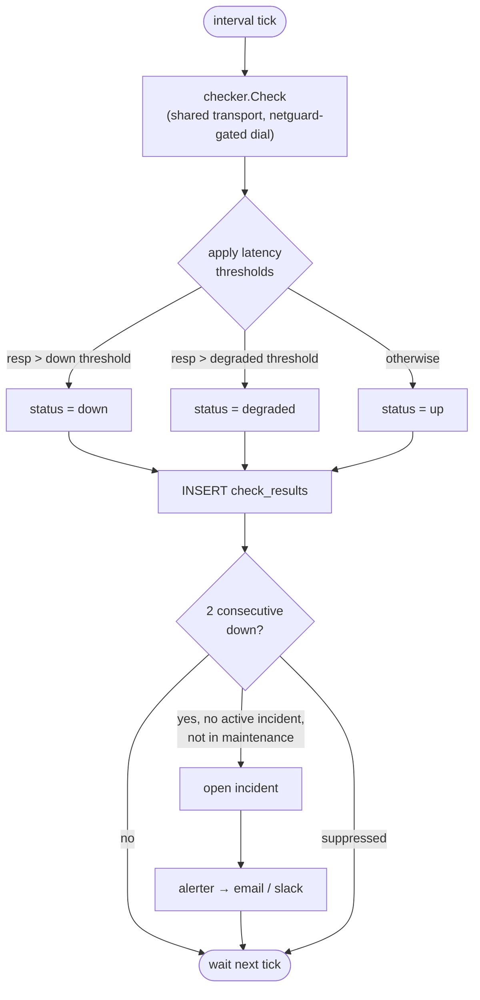

# Pulse

[](https://github.com/memetics19/pulse/actions/workflows/ci.yml)
[](go.work)
[](LICENSE.md)

Pulse is an open-source, self-hosted status page and monitoring tool. It ships as a single Go binary with a SQLite database. The monitoring worker runs in the same process, so there is no separate database server, Node.js runtime, or reverse proxy required to run it. Pulse checks your services, records uptime and latency, opens incidents when checks fail, and serves public status pages on your own domains.

A live status page runs at [status.shreeda.xyz](https://status.shreeda.xyz). The full documentation is at [docs.shreeda.xyz](https://docs.shreeda.xyz).

<!---->

## Highlights

- **Single binary and SQLite.** One Go binary plus one SQLite file. The monitoring worker runs in-process.
- **Multiple status pages on custom domains.** Each page has its own domain, title, and selected monitor groups. Pulse resolves the page from the request Host header.
- **Scoped API keys.** Named, revocable keys with granular scopes (for example `monitors:read`, `incidents:write`). Keys are shown once at creation and stored as a hash.
- **Built-in theming.** Presets, logo and favicon upload, a customizable footer, CSS variable overrides, per-page branding, and a visitor dark-mode toggle.
- **Structured incidents with required RCA.** A defined lifecycle from detected to resolved. A root cause analysis is required before an incident can be resolved.
- **Scheduled maintenance with alert suppression.** Maintenance windows transition automatically. While a window is active, alerts and auto-incidents are suppressed for the affected monitors.
- **TOTP two-factor authentication.** Optional time-based one-time passwords using an authenticator app.
- **Atom feed.** The public page exposes an Atom feed for incident updates.
- **Local-timezone rendering.** All times render in the visitor's local timezone.

## Architecture

Pulse runs as one Go binary with an in-process monitoring worker and a single
SQLite file. The optional `pulse-agent` pushes host metrics. The REST API, the
public status pages and the embedded admin UI are all served by the same process.



Each monitor runs on its own interval. A check result goes through the latency
thresholds and is recorded. After two failures in a row, outside a maintenance
window, Pulse opens an incident and sends alerts:



## Quick start

Pulse is a single static binary with no runtime dependencies. The installer
picks the binary for your OS and CPU (Linux or macOS, amd64 or arm64), checks
its checksum and installs it. It asks for the port, the data directory, HTTPS,
and whether monitors may reach your LAN. On Linux it also sets up a `systemd`
service:

```bash
curl -fsSL https://raw.githubusercontent.com/memetics19/pulse/main/deploy/install.sh | sh
```

On Debian or Ubuntu, install the package from the signed apt repository instead. It runs
Pulse as a `systemd` service under its own user, keeps its data in `/var/lib/pulse`, and
`apt upgrade` brings new releases:

```bash
sudo install -d -m 0755 /etc/apt/keyrings
curl -fsSL https://apt.shreeda.xyz/key.gpg | sudo tee /etc/apt/keyrings/memetics19.gpg >/dev/null
echo "deb [signed-by=/etc/apt/keyrings/memetics19.gpg] https://apt.shreeda.xyz stable main" |
  sudo tee /etc/apt/sources.list.d/memetics19.list
sudo apt update && sudo apt install pulse
```

Settings are in `/etc/pulse/pulse.env`. Every server setting has a `PULSE_` name, such as
`PULSE_PORT` and `PULSE_DB`. Pulse 3.0 renamed `API_PORT` and `SQLITE_PATH`, and the
old names work with a warning until 4.0. See
[Configuration](docs/configuration.md). `pulse-agent` and `pulse-cli` are packages there
too. Each release also has `.deb` and `.rpm` files.

Prefer containers? Run it with Docker Compose instead:

```bash
git clone https://github.com/memetics19/pulse.git
cd pulse
docker compose up -d
```

Open `http://localhost:8080`. On first start, every route redirects to a setup wizard. Enter the setup token that Pulse prints in its log (`docker compose logs pulse | grep "setup token"`), create the admin account and set branding. The server picks the SQLite file from `PULSE_DB` or `PULSE_DATA_DIR`. After setup the app runs normally.

To serve a public page such as `status.shreeda.xyz` over HTTPS, run a reverse proxy in front of Pulse that terminates TLS and forwards to port 8080. See the status pages documentation for Caddy and nginx examples.

## Documentation

Full documentation is at [docs.shreeda.xyz](https://docs.shreeda.xyz). The Markdown sources live in [`docs/`](docs/index.md):

- [Getting started](docs/getting-started.md)
- [Configuration](docs/configuration.md)
- [Monitors](docs/monitors.md)
- [Incidents](docs/incidents.md)
- [Maintenance](docs/maintenance.md)
- [Status pages](docs/status-pages.md)
- [Theming](docs/theming.md)
- [API](docs/api.md)
- [Security](docs/security.md)
- [Architecture](docs/architecture.md)
- [Roadmap](docs/roadmap.md)

## Contributing

Issues and pull requests are welcome. [CONTRIBUTING.md](CONTRIBUTING.md) covers the
development setup, commit style and how releases work. Report security issues
privately as described in [SECURITY.md](SECURITY.md).

## License

Pulse is released under the MIT License. See [LICENSE.md](LICENSE.md).
